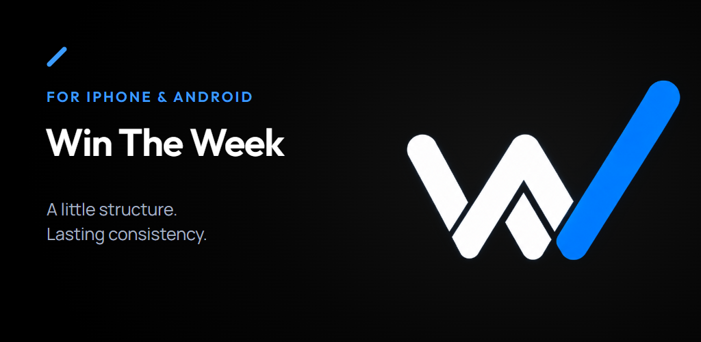

# Win The Week

A weekly planner for recurring routines. You set up the things you want to do each week (gym 3 times, read 4 times, etc.), plan which days they go on, and then tick them off from a simple daily checklist.

[Get it on Google Play](https://play.google.com/store/apps/details?id=com.tamimshuhel.wintheweek) · [Website](https://wintheweek.tamimshuhel.com) · [Promo video](https://www.youtube.com/watch?v=dyJPFnVHGJ4)

Android is out now. iOS is coming later.

## Screenshots

<table>
  <tr>
    <td>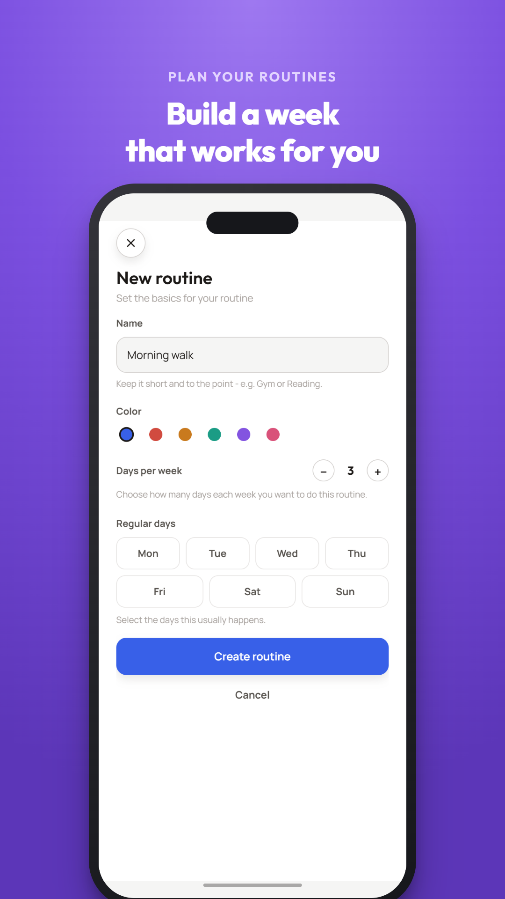</td>
    <td>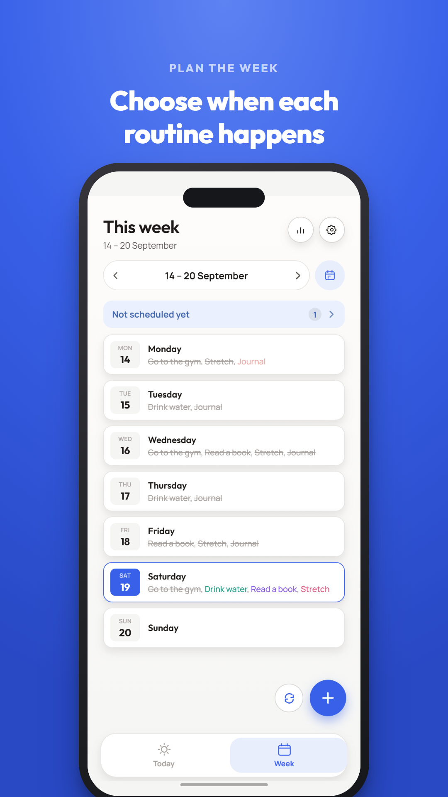</td>
    <td>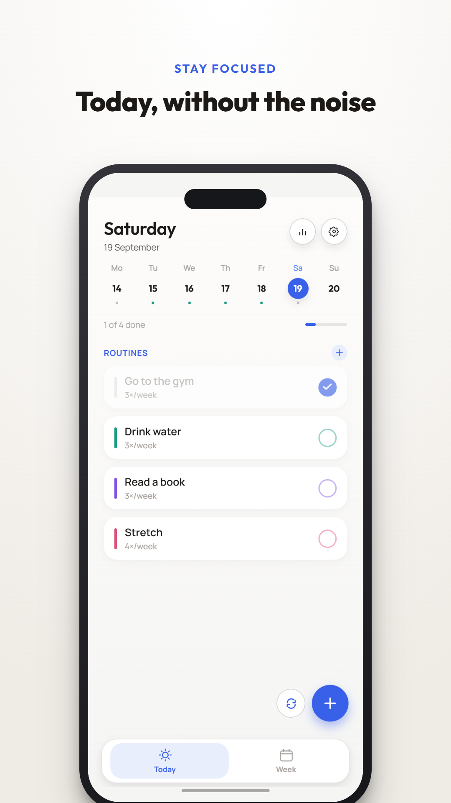</td>
  </tr>
  <tr>
    <td>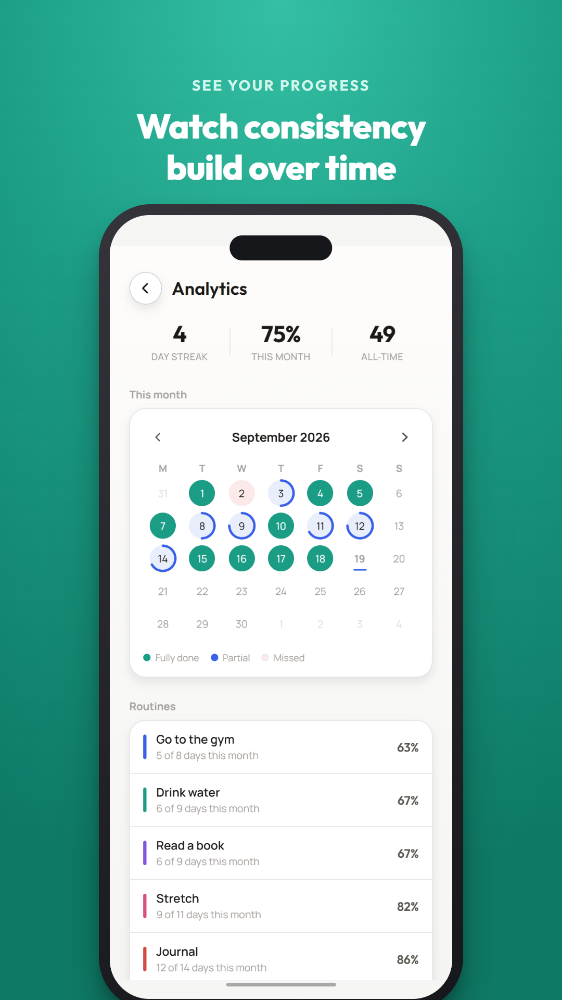</td>
    <td>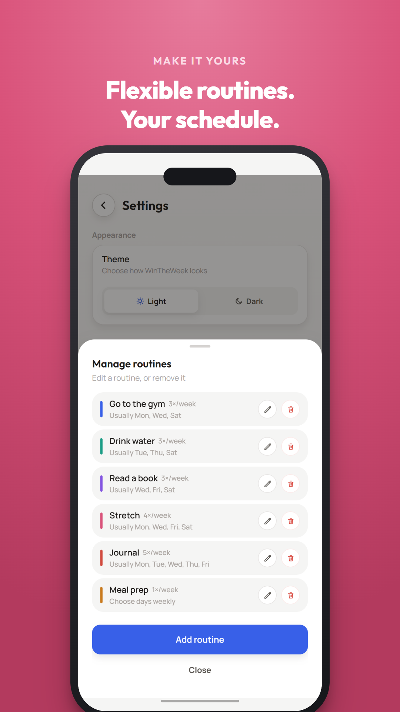</td>
    <td>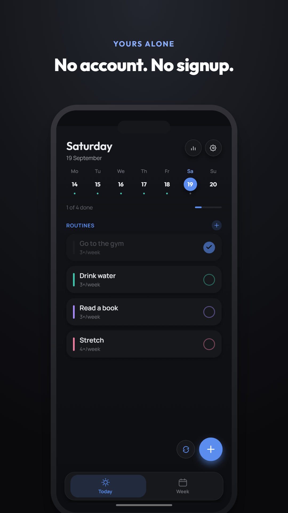</td>
  </tr>
</table>

Some recordings from the app (these are also used in the onboarding):

<table>
  <tr>
    <td>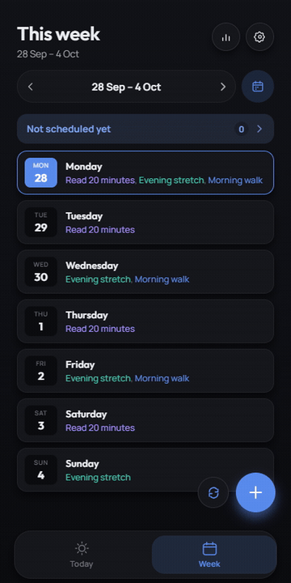</td>
    <td>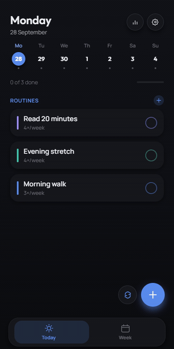</td>
    <td>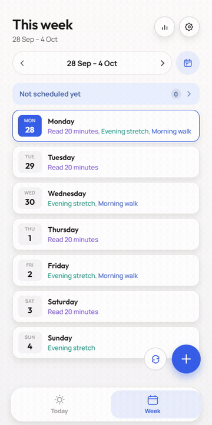</td>
    <td>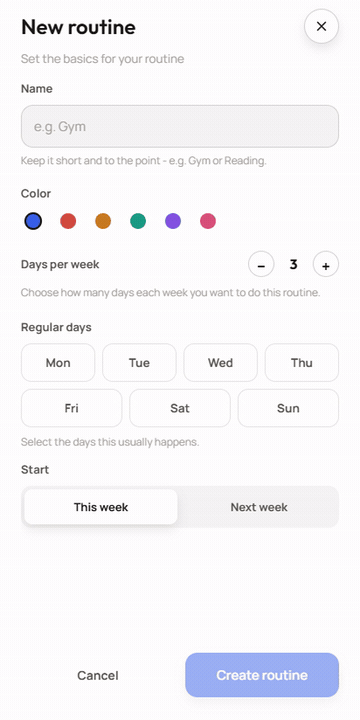</td>
  </tr>
</table>

## What it does

- **Week screen:** shows all 7 days and which routines are on each one. Routines you haven't planned for that week yet show up under "Not scheduled yet".
- **Today screen:** a checklist of today's routines. You can drag them into whatever order you like.
- **Routines:** each one has a colour and a target number of times per week. You can give it regular days or plan it week by week.
- **Progress:** current streak, this month's completion rate, and a calendar showing how much of each day you got done.
- **Light and dark mode.**
- No account and nothing sent to a server. All data stays on the phone.

A couple of rules I wanted the app to stick to:

- Past days can't be edited. You can't tick off, move or add things to a day that's already gone.
- Changing a routine's regular days doesn't rewrite your history. You choose whether the change starts this week or next week.
- Ticking something off doesn't move it in the list.

## Tech

- Expo SDK 57, React Native 0.86, React 19
- TypeScript (strict)
- AsyncStorage for saving data
- react-native-svg for icons and the progress rings
- EAS Build for Android builds

I kept dependencies to a minimum. There's no navigation library, no Redux, and no Reanimated or gesture-handler. Screen switching is just state, all app state lives in one context (`src/state/AppState.tsx`), and the drag-to-reorder list is built with React Native's own `Animated` and `PanResponder`.

### How scheduling works

The main data type is `Routine` (in `src/data/types.ts`). A routine has:

- `defaultDays`: the days it normally happens
- `schedule`: overrides for specific weeks, keyed by the Monday of that week
- `defaultDaysHistory`: older `defaultDays` values, so editing a routine doesn't change past weeks
- `doneDates`: completions, keyed by the actual date

`daysForWeek()` in `src/data/schedule.ts` works out which days a routine falls on in a given week. Every screen uses it, so the Week screen, Today screen and stats always agree. Stats in `src/data/analytics.ts` are calculated from the routines rather than stored separately.

Saved data is versioned, and older saved data gets migrated when the app loads, so updates don't wipe anyone's routines.

More detail is in [`docs/PROJECT.md`](docs/PROJECT.md), and the reasons behind some of the less obvious choices are in [`docs/DECISIONS.md`](docs/DECISIONS.md).

## Running it

```bash
npm install
npx expo start
```

Press `a` for Android, `i` for iOS, `w` for web, or scan the QR code with Expo Go.

Other commands:

```bash
npx tsc --noEmit                    # type check
npm run build:android:preview       # APK build (EAS)
npm run build:android:production    # Play Store .aab build (EAS)
```

## Folders

```
App.tsx                app root
src/state/             app state
src/data/              types, scheduling and stats logic
src/screens/           Week, Today, Analytics, Settings
src/components/        UI components, bottom sheet, onboarding
src/theme/             colours, fonts, light/dark theme
docs/                  project notes
website/               landing page and privacy policy
marketing/video/       promo video (made with Remotion)
marketing/play-store/  store screenshots
```

## Privacy

There's no backend. Everything is stored on the device, and Settings → Reset app data deletes it. See the [privacy policy](website/privacy.html).
