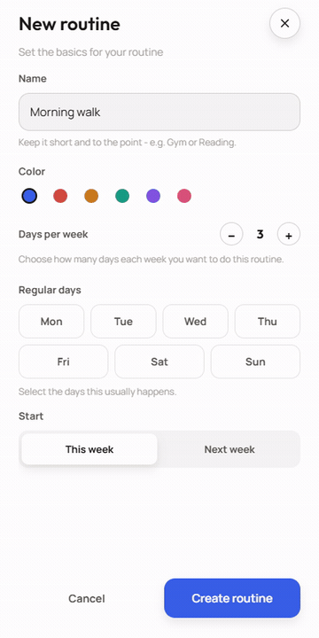
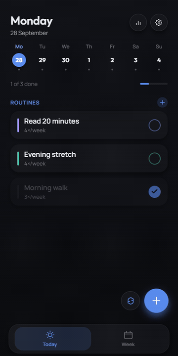
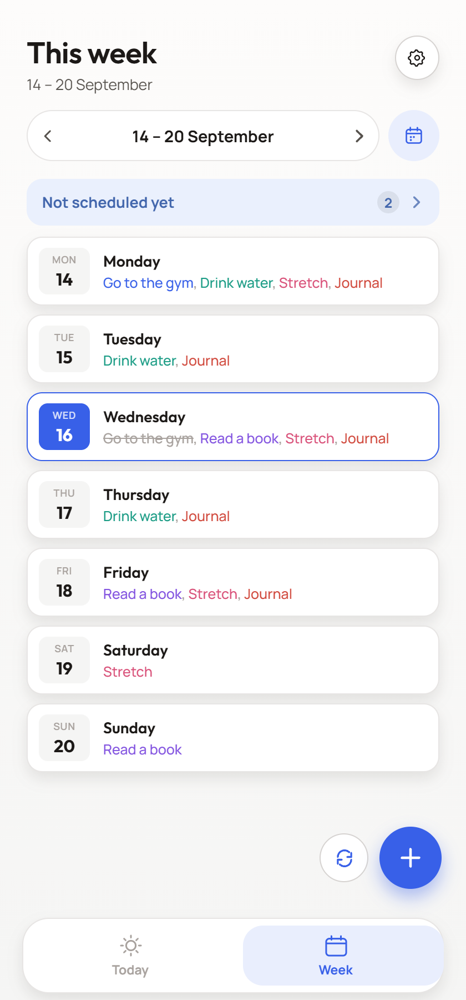
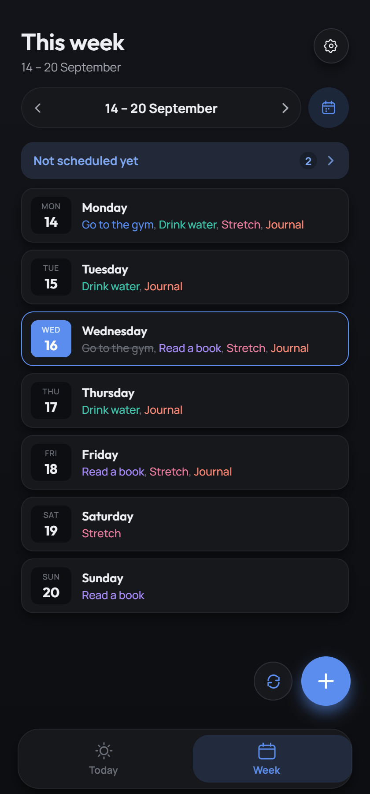
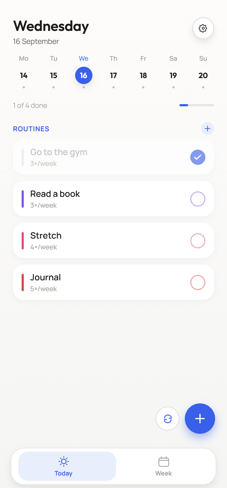
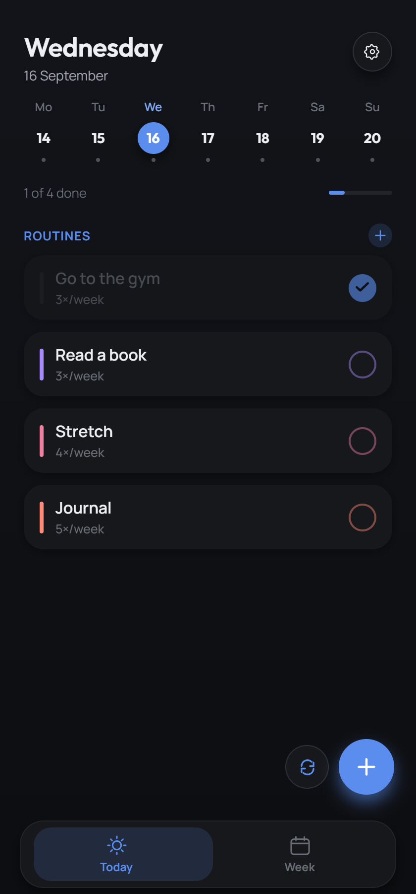
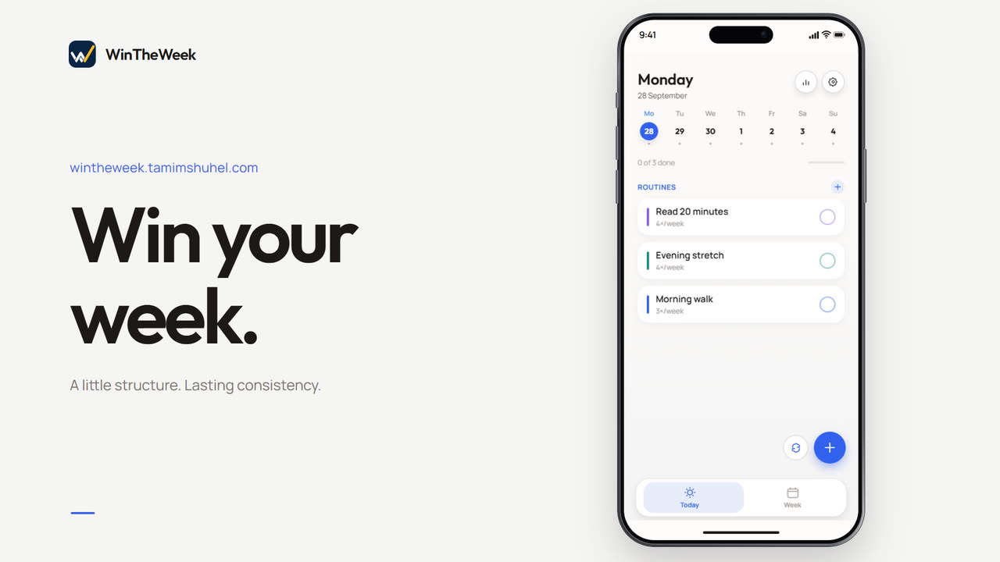
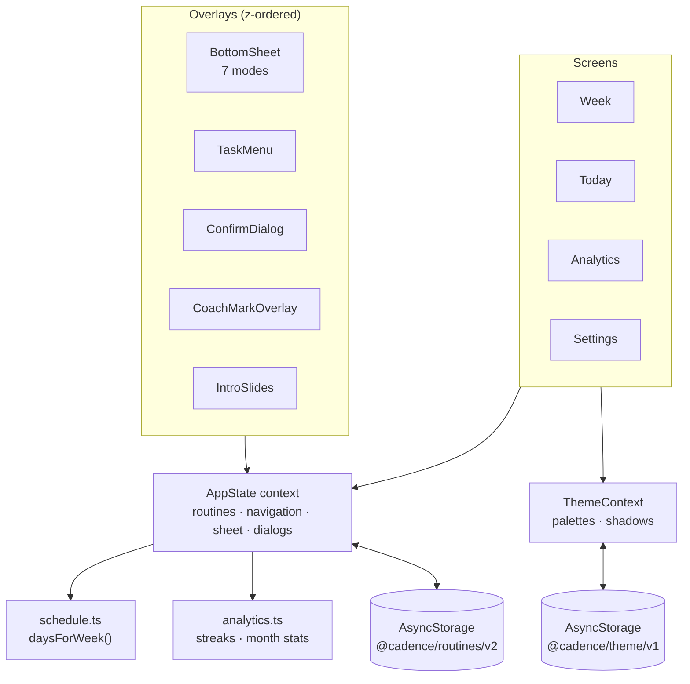

<div align="center">


<br />

# Win The Week

**A calm, colour-coded weekly planner for the routines you actually want to keep.**

Plan the whole week on one screen, then open **Today** for a focused checklist of exactly what's due. Nothing else.

<br />

<a href="https://play.google.com/store/apps/details?id=com.tamimshuhel.wintheweek"></a>
<a href="https://wintheweek.tamimshuhel.com"></a>
<a href="https://www.youtube.com/watch?v=dyJPFnVHGJ4"></a>

<br />


</div>

---

## 📱 Screenshots

<table>
  <tr>
    <td align="center"></td>
    <td align="center"></td>
    <td align="center"></td>
  </tr>
  <tr>
    <td align="center"></td>
    <td align="center"></td>
    <td align="center"></td>
  </tr>
</table>

### In motion

Real screen recordings of the app — the same clips power the in-app onboarding.

<table>
  <tr>
    <td align="center"><br /><sub><b>Today's checklist</b></sub></td>
    <td align="center"><br /><sub><b>Check it off</b></sub></td>
    <td align="center"><br /><sub><b>The whole week</b></sub></td>
  </tr>
  <tr>
    <td align="center"><br /><sub><b>Create a routine</b></sub></td>
    <td align="center"><br /><sub><b>Pick its days</b></sub></td>
    <td align="center"><br /><sub><b>Move it around</b></sub></td>
  </tr>
</table>

### Light & dark

<table>
  <tr>
    <td align="center"></td>
    <td align="center"></td>
    <td align="center"></td>
    <td align="center"></td>
  </tr>
</table>

### 🎬 Promo video

<a href="https://www.youtube.com/watch?v=dyJPFnVHGJ4"></a>

---

## ✨ Features

| | |
|---|---|
| 🗓️ **Week view** | All seven days on one screen, with each day's routines listed in their colour. Anything not yet planned for the week sits in a "Not scheduled yet" group. |
| ✅ **Today view** | Just today's routines as a checklist, with a progress bar and a day strip to glance at the rest of the week. |
| 🔁 **Routines, not tasks** | Every item is a recurring commitment with a weekly target (e.g. *3× / week*) and a colour. Give it regular days, or plan it week by week. |
| ✋ **Drag to reorder** | Long-press and drag to rearrange a day. Reordering one day never reshuffles another, and ticking something off never moves it. |
| 📊 **Progress & streaks** | Current streak, this month's completion rate, an all-time count, and a month calendar where each day is a progress ring. |
| 🔒 **Honest history** | Past days are read-only. Changing a routine's regular days applies from this week or next (your choice) and never rewrites what already happened. |
| 🎨 **Light & dark themes** | Hand-tuned palettes: warm-grey neutrals in light mode, blue-grey in dark, six routine colours that adapt to both. |
| 👋 **Onboarding** | A short intro using real app footage, then a three-step spotlight tour of the key controls. Can be replayed from Settings. |
| 🛡️ **Private by design** | No account, no cloud, no tracking. Everything is stored on your device. |

---

## 🧱 Tech stack

| Layer | Choice |
|---|---|
| Framework | [Expo](https://expo.dev) SDK 57 · React Native 0.86 · React 19 |
| Language | TypeScript in `strict` mode |
| State | A single React context (`useState` / `useMemo` / `useCallback`) — no Redux, Zustand or MobX |
| Navigation | App-level screen state — no router library |
| Persistence | `@react-native-async-storage/async-storage`, versioned keys with validated restore and migration |
| Animation & gestures | Core RN `Animated` + `PanResponder` — **no Reanimated, no gesture-handler** |
| Graphics | `react-native-svg` for every icon, progress ring and the onboarding spotlight mask |
| Typography | Outfit (headings) and Manrope (body) via `@expo-google-fonts` |
| Builds | EAS Build — APK for internal testing, App Bundle (`.aab`) for Google Play |
| Marketing | [Remotion](https://www.remotion.dev) promo video and a static landing page, both in this repo |

---

## 🏗️ Architecture



### The data model

A **routine** is the one core object. Everything else (a day's checklist, the week board, analytics) is derived from it.

```ts
interface Routine {
  id: string;
  title: string;
  color: RoutineColorId;                       // 'blue' | 'red' | … — resolved to hex per theme
  timesPerWeek: number;
  defaultDays: DayKey[];                       // the usual weekly rhythm
  defaultDaysHistory: { untilIso; days }[];    // superseded rhythms, so edits never rewrite the past
  schedule: Record<WeekId, DayKey[]>;          // per-week overrides ("this week, Tue + Thu instead")
  doneDates: Record<IsoDate, boolean>;         // completion keyed by real calendar date
  order: number;                               // default position
  dayOrder: Record<IsoDate, number>;           // per-day drag overrides
}
```

### One resolver, every screen

`daysForWeek(routine, weekId)` in [`src/data/schedule.ts`](src/data/schedule.ts) is the **single** answer to "which days does this routine land on this week?". Week, Today, the planning sheets and Analytics all go through it, so they can never disagree.

1. If the week has an explicit entry in `schedule`, use it. An empty array means "cleared this week", which is different from having no entry.
2. Otherwise resolve **each day independently** against whichever `defaultDays` snapshot applied on that real date.
3. Drop any date before the routine was created.

Resolving per day rather than per week is what makes mid-week edits safe: the days already gone keep the old rhythm, and today onward picks up the new one.

---

## 🔬 Engineering highlights

<details>
<summary><b>Hand-built drag-and-drop with zero gesture dependencies</b></summary>

<br />

[`DraggableTaskList.tsx`](src/components/DraggableTaskList.tsx) implements long-press-to-drag reordering using only `PanResponder` and `Animated`. Each row owns an animated `top` that eases into its slot as the order changes. The row being dragged follows the finger through a JS-driven `translateY`, while the pickup scale and wiggle run on the native driver on a separate nested view, so the two never share an animated props node. Dropping writes only that date's `dayOrder`; no other day's list is touched.

</details>

<details>
<summary><b>SVG-mask spotlight for the onboarding tour</b></summary>

<br />

[`CoachMarkOverlay.tsx`](src/components/onboarding/CoachMarkOverlay.tsx) cuts a rounded "hole" in a dark scrim with a `react-native-svg` luminance `Mask`. The cut-out's `x/y/width/height` are animated through `Animated.createAnimatedComponent(Rect)`, with an accent ring and a looping radar-ping pulse drawn on top. Targets register their own refs (`collapsable={false}` so Android's view flattening can't drop them), and measurement waits two animation frames so a slower device can finish layout first.

</details>

<details>
<summary><b>Versioned, validated, migratable persistence</b></summary>

<br />

Routines are saved under `@cadence/routines/v2`. The restore step checks the structure and rejects malformed data instead of half-trusting it, then falls back to migrating the older `v1` shape (flat `days` → `defaultDays`, weekday-keyed completion → real-date completion). Fields added later (`order`, `dayOrder`, `defaultDaysHistory`) are read as optional with defaults, so existing installs keep working through every update.

</details>

<details>
<summary><b>Past days are locked — enforced in state, not just hidden in the UI</b></summary>

<br />

Any date before today is read-only: no ticking off, reordering, moving, adding or removing. The guard lives in `AppState` itself, because the Week screen can browse back to any past week. The UI also dims and disables the matching controls, but it's the state layer that guarantees it.

</details>

<details>
<summary><b>Analytics computed from the source of truth</b></summary>

<br />

Nothing is stored just for analytics. [`src/data/analytics.ts`](src/data/analytics.ts) is a set of pure functions over `routines` that resolve "planned" the same way the Today screen does. Streaks skip days with nothing planned and don't break on an unfinished today. Month stats only count days up to today, so an in-progress month isn't dragged down by days that haven't happened yet.

</details>

<details>
<summary><b>Android polish</b></summary>

<br />

Expo 57 renders edge-to-edge with a transparent status bar, so the app paints its own theme-aware underlay, sized from the safe-area inset and the native status-bar height, with an `expo-system-ui` fallback set before first paint. Every `ScrollView` disables Android's accent-coloured overscroll glow, text in tight pills uses a shared font-metric fix for vertical centring, and the system back button closes the top-most overlay before navigating.

</details>

> The reasoning behind these choices is written up in [`docs/DECISIONS.md`](docs/DECISIONS.md), and the full system description in [`docs/PROJECT.md`](docs/PROJECT.md).

---

## 🚀 Getting started

**Requirements:** Node.js 20+ and npm. For a device, install Expo Go or use an Android emulator / iOS simulator.

```bash
git clone https://github.com/TamGamer97/WinTheWeek.git
cd WinTheWeek
npm install
npx expo start
```

Then press <kbd>a</kbd> for Android, <kbd>i</kbd> for iOS, <kbd>w</kbd> for web, or scan the QR code with Expo Go.

### Scripts

| Command | What it does |
|---|---|
| `npm start` | Start the Expo dev server |
| `npm run android` / `ios` / `web` | Start and open on a specific platform |
| `npx tsc --noEmit` | Type-check the whole app (the project's main quality gate) |
| `npm run build:android:preview` | EAS build of an installable APK |
| `npm run build:android:production` | EAS build of a Google Play App Bundle |

---

## 🗂️ Project structure

```
App.tsx                       Root: fonts, providers, status bar, back handling, overlays
src/
├── state/AppState.tsx        All app state and actions in one context
├── data/
│   ├── types.ts              Routine, RoutineInstance, SheetMode, ScreenName …
│   ├── schedule.ts           daysForWeek() — the single schedule resolver
│   ├── analytics.ts          Pure streak / completion helpers
│   └── seed.ts               Empty fresh-install state
├── screens/                  Week, Today, Analytics, Settings
├── components/
│   ├── BottomSheet.tsx       One sheet, seven content modes
│   ├── DraggableTaskList.tsx Drag-to-reorder list
│   ├── ProgressRingCalendar  Month grid of completion rings
│   ├── onboarding/           IntroSlides + CoachMarkOverlay tour
│   └── sheet/                Shared form rows, pickers and controls
├── theme/                    Palettes, routineColorHex(), shadows, fonts
├── icons/Icons.tsx           Every icon, as SVG
└── utils/date.ts             Monday-start week and month-grid helpers

assets/                       App icon, splash, onboarding GIFs
docs/                         PROJECT.md (how it works) · DECISIONS.md (why)
website/                      Landing page + privacy policy
marketing/
├── video/                    Remotion promo film built from real app recordings
├── play-store/               Store listing screenshots and feature graphic
└── app-icon/                 Icon sets for iOS and Android
```

---

## 🎥 Marketing toolkit

The launch materials live in the repo next to the app:

- **[`marketing/video/`](marketing/video/)**: a standalone [Remotion](https://www.remotion.dev) project that renders the promo film from real screen recordings of the app, framed in a device mockup, with scene copy and timing kept in `src/story.ts`.
- **[`website/`](website/)**: the static landing page at [wintheweek.tamimshuhel.com](https://wintheweek.tamimshuhel.com), with light/dark screenshots, the embedded promo and the [privacy policy](website/privacy.html).
- **[`marketing/play-store/`](marketing/play-store/)**: the Google Play screenshots and feature graphic shown above.

---

## 🔐 Privacy

Win The Week has no backend. There's no account, no analytics SDK and no network sync: routines, completion history and preferences are stored in AsyncStorage on the device and nowhere else. **Settings → Reset app data** clears all of it. Full policy: [`website/privacy.html`](website/privacy.html).

---

<div align="center">


**Win the week, one day at a time.**

<a href="https://play.google.com/store/apps/details?id=com.tamimshuhel.wintheweek">Google Play</a> ·
<a href="https://wintheweek.tamimshuhel.com">Website</a> ·
<a href="https://www.youtube.com/watch?v=dyJPFnVHGJ4">Promo video</a>

<sub>Built by Tamim with Expo and React Native.</sub>

</div>
